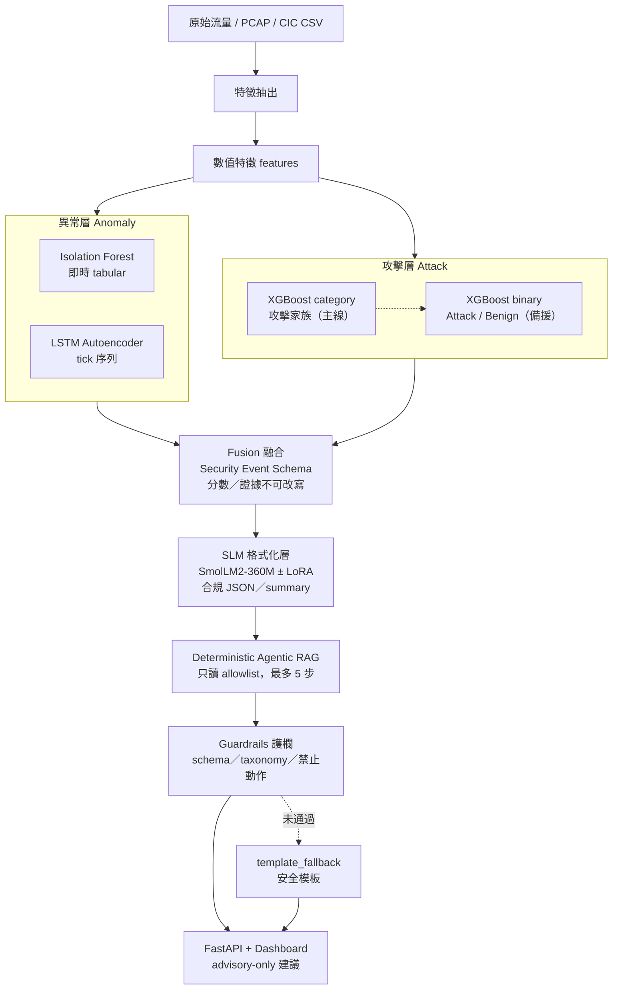

# 模型準確度與訓練前後對比

| 欄位 | 內容 |
|---|---|
| 用途 | 彙整 XGBoost／LSTM 偵測指標，以及 SmolLM2 微調前後 holdout 對比 |
| 資料來源 | `artifacts/classifiers/`、`artifacts/lstm_training_report.json`、`artifacts/slm/holdout_10/` |
| 說明 | 下列為研究預覽抽樣結果，非全 corpus 臨床驗證聲明 |

---

## 0. 整體架構

資料流一句話：特徵 →（異常層 IF＋LSTM ∥ 攻擊層 XGBoost）→ 融合 → SLM 整理 → RAG → 護欄 → API／畫面。  
偵測分數與證據屬 **detector-owned**，後續 SLM／RAG **不得改寫**。



圖例對應本文章節：§1 XGBoost、§2 LSTM、§3 SLM 訓練前後。

---

## 1. XGBoost（攻擊層）

評估設定：CICIoMT 官方 split 抽樣（約每檔固定列數），見 `logreg_xgb_comparison.json`。

### 1.1 Binary（Benign vs Attack）

| 模型 | Accuracy | F1（Attack） | ROC-AUC | PR-AUC | 測試列數 |
|---|---|---|---|---|---|
| Logistic Regression | 0.945 | 0.971 | 0.943 | 0.997 | 10186 |
| **XGBoost** | **0.974** | **0.986** | **0.992** | **1.000** | 10186 |

XGBoost 明顯優於 LR（二分類）。

### 1.2 Category（攻擊家族）

| 模型 | Accuracy | Macro-F1 | 測試列數 |
|---|---|---|---|
| Logistic Regression | 0.467 | 0.425 | 9686 |
| **XGBoost** | **0.879** | **0.899** | 9686 |

| 類別（XGB） | Precision | Recall | F1 | Support |
|---|---|---|---|---|
| benign | 0.907 | 0.900 | 0.904 | 500 |
| ddos | 0.997 | 0.748 | 0.854 | 4000 |
| dos | 0.748 | 0.997 | 0.855 | 3000 |
| mqtt | 0.914 | 0.936 | 0.925 | 500 |
| recon | 0.960 | 0.957 | 0.958 | 1686 |

Macro-F1 相對 LR 提升約 **+0.47**。

### 1.3 Leave-one-attack-family-out（XGB binary）

| 指標 | 數值 |
|---|---|
| mean ROC-AUC | **0.992** |
| std ROC-AUC | 0.013 |

代表換一個攻擊家族當 holdout 時，二分類辨識力仍高（抽樣條件下）。

---

## 2. LSTM Autoencoder（異常層／時序）

### 2.1 訓練摘要（`lstm_training_report.json`）

| 項目 | 數值 |
|---|---|
| 良性訓練序列 | 63 |
| 良性驗證序列 | 21 |
| Tick 數 | 136 |
| seq_len | 10 |
| tick_seconds | 60 |
| epochs | 10 |
| final_train_loss | 0.605 |
| threshold（q=0.99） | 0.685 |

LSTM 是 **benign-only 重建誤差** 異常偵測，不是「攻擊類別分類準確率」。

### 2.2 與 Isolation Forest 比較（合成時序 `sample_flows`）

來源：`if_vs_lstm.json`（因官方 CIC CSV 缺可信時間戳／device session，故用合成時序）。

| 模型 | 評估單位 | ROC-AUC | PR-AUC |
|---|---|---|---|
| Isolation Forest | 408 tabular rows | 1.00 | 1.00 |
| LSTM AE | 120 sequences | 1.00 | 1.00 |

數字極高，反映**合成資料可分性強**；**不能**直接當成 CIC 官方 CSV 上的實戰準確率。

---

## 3. SmolLM2 訓練前後對比（同一 10 筆 CIC holdout）

任務：產出合規 JSON（summary／taxonomy／evidence_ids／intents／status）。  
指標：嚴格 schema／allowlist 通過率（`generation_status=generated`）。

| 階段 | 模型 | 通過 | Fallback |
|---|---|---|---|
| **Before** | base `SmolLM2-360M-Instruct`（未 LoRA） | **2 / 10** | 8 / 10 |
| **After** | A+B LoRA（enum drill + chat_template） | **8 / 10** | 2 / 10 |

**提升：+6 筆通過護欄（+60 個百分點）。**

### 3.1 逐筆 SLM 回答對照（Before vs After）

下列為模型**原始輸出**（`raw_model_output`）與護欄套用後結果。
`generated` = 通過 schema／allowlist；`template_fallback` = 未通過，改用模板。

| ID | 家族 | Before | After |
|---|---|---|---|
| h01 | benign | template_fallback | template_fallback |
| h02 | ddos | template_fallback | generated |
| h03 | dos | generated | generated |
| h04 | mqtt | template_fallback | generated |
| h05 | recon | template_fallback | generated |
| h06 | spoofing | generated | generated |
| h07 | benign | template_fallback | template_fallback |
| h08 | ddos | template_fallback | generated |
| h09 | dos | template_fallback | generated |
| h10 | mqtt | template_fallback | generated |

#### h01（benign／label=`Benign`）

- 偵測器：category=`recon`，p≈0.749456

**Before（base SmolLM2）**

- 護欄結果：`template_fallback`；套用 taxonomy=`insufficient_evidence`
- 驗證錯誤：taxonomy not allowlisted: recon

原始輸出：

```json
{
  "summary_en": "An anomaly was detected in the test.csv file.",
  "taxonomy": "recon",
  "evidence_ids": [
    "ev_1",
    "ev_2",
    "ev_3"
  ],
  "retrieval_intents": [
    "asset_context",
    "behavior_baseline",
    "threat_context",
    "playbook_lookup",
    "related_events"
  ],
  "status": "ok",
  "retrieval_intents_list": [
    "asset_context",
    "behavior_baseline",
    "threat_context",
    "playbook_lookup",
    "related_events"
  ],
  "evidence_ids_list": [
    "ev_1",
    "ev_2",
    "ev_3"
  ],
  "none": "none"
}
```

套用後 summary：medical_aiot event is assessed as known_attack_suspected using only supplied detector evidence. Severity remains policy-owned; no detector scores were modified.

**After（A+B LoRA）**

- 護欄結果：`template_fallback`；套用 taxonomy=`insufficient_evidence`
- 驗證錯誤：taxonomy not allowlisted: evidence-0.1

原始輸出：

```json
{
  "summary_en": "medical_aiot (cic-h01) in state=unknown has known_attack_category=recon with detector_version=0.1.0-xgb. Verdict is known_attack_suspected. No evidence is provided. Severity is medium.",
  "taxonomy": "evidence-0.1",
  "evidence_ids": [
    "ev_1",
    "ev_2",
    "ev_3",
    "ev_4"
  ],
  "retrieval_intents": [
    "asset_context",
    "behavior_baseline"
  ],
  "status": "ok"
}
```

套用後 summary：medical_aiot event is assessed as known_attack_suspected using only supplied detector evidence. Severity remains policy-owned; no detector scores were modified.

#### h02（ddos／label=`TCP IP-DDoS-UDP1`）

- 偵測器：category=`ddos`，p≈0.999958

**Before（base SmolLM2）**

- 護欄結果：`template_fallback`；套用 taxonomy=`insufficient_evidence`
- 驗證錯誤：taxonomy not allowlisted: ddos

原始輸出：

```json
{
  "summary_en": "A DDoS attack was detected.",
  "taxonomy": "ddos",
  "evidence_ids": [
    "ev_1",
    "ev_2",
    "ev_3",
    "ev_4"
  ],
  "retrieval_intents": [
    "asset_context",
    "behavior_baseline",
    "threat_context",
    "playbook_lookup",
    "related_events"
  ],
  "status": "ok"
}
```

套用後 summary：medical_aiot event is assessed as known_attack_suspected using only supplied detector evidence. Severity remains policy-owned; no detector scores were modified.

**After（A+B LoRA）**

- 護欄結果：`generated`；套用 taxonomy=`insufficient_evidence`

原始輸出：

```json
{
  "summary_en": "medical_aiot (cic-h02) in state=unknown has insufficient evidence to reliably label as known_attack_suspected. Verdict context is known_attack_suspected; evidence context is insufficient_evidence. Do not use status values like inconclusive or partial_detection. Do not invent intents like assessment_context or run_shell.",
  "taxonomy": "insufficient_evidence",
  "evidence_ids": [
    "ev_1",
    "ev_2",
    "ev_3",
    "ev_4"
  ],
  "retrieval_intents": [
    "asset_context",
    "behavior_baseline"
  ],
  "status": "insufficient_evidence"
}
```

#### h03（dos／label=`TCP IP-DoS-SYN`）

- 偵測器：category=`dos`，p≈0.999971

**Before（base SmolLM2）**

- 護欄結果：`generated`；套用 taxonomy=`network_behavior_anomaly`

原始輸出：

```json
{
  "summary_en": "A network behavior anomaly is detected.",
  "taxonomy": "network_behavior_anomaly",
  "evidence_ids": [
    "ev_1",
    "ev_2",
    "ev_3"
  ],
  "retrieval_intents": [
    "asset_context",
    "behavior_baseline",
    "threat_context",
    "playbook_lookup",
    "related_events"
  ],
  "status": "ok",
  "retrieval_intents_list": [
    "asset_context",
    "behavior_baseline",
    "threat_context",
    "playbook_lookup",
    "related_events"
  ],
  "evidence_ids_list": [
    "ev_1",
    "ev_2",
    "ev_3"
  ],
  "none": "none"
}
```

**After（A+B LoRA）**

- 護欄結果：`generated`；套用 taxonomy=`insufficient_evidence`

原始輸出：

```json
{
  "summary_en": "medical_aiot (cic-h03) in state=unknown has insufficient evidence to inform a secure baseline. Verdict context is known_attack_suspected; evidence only includes detector outputs and known attack category. Severity remains inconclusive.",
  "taxonomy": "insufficient_evidence",
  "evidence_ids": [
    "ev_1",
    "ev_2",
    "ev_3",
    "ev_4"
  ],
  "retrieval_intents": [
    "asset_context",
    "behavior_baseline"
  ],
  "status": "insufficient_evidence"
}
```

#### h04（mqtt／label=`MQTT-Malformed Data`）

- 偵測器：category=`mqtt`，p≈0.989976

**Before（base SmolLM2）**

- 護欄結果：`template_fallback`；套用 taxonomy=`insufficient_evidence`
- 驗證錯誤：taxonomy not allowlisted: mqtt

原始輸出：

```json
{
  "summary_en": "An anomaly was detected in the MQTT traffic.",
  "taxonomy": "mqtt",
  "evidence_ids": [
    "ev_1",
    "ev_2",
    "ev_3",
    "ev_4"
  ],
  "retrieval_intents": [
    "asset_context",
    "behavior_baseline",
    "threat_context",
    "playbook_lookup",
    "related_events"
  ],
  "status": "ok"
}
```

套用後 summary：medical_aiot event is assessed as known_attack_suspected using only supplied detector evidence. Severity remains policy-owned; no detector scores were modified.

**After（A+B LoRA）**

- 護欄結果：`generated`；套用 taxonomy=`insufficient_evidence`

原始輸出：

```json
{
  "summary_en": "medical_aiot (cic-h04) in state=unknown has insufficient evidence to reliably label as known_attack_suspected. Verdict context is known_attack_suspected. No detector outputs are used. Known-attack detector reports category=mqtt with probability=0.989976. Anomaly detector outputs are null. No evidence is provided for detector fallback.",
  "taxonomy": "insufficient_evidence",
  "evidence_ids": [
    "ev_1",
    "ev_2",
    "ev_3",
    "ev_4"
  ],
  "retrieval_intents": [
    "asset_context",
    "playbook_lookup"
  ],
  "status": "insufficient_evidence"
}
```

#### h05（recon／label=`Recon-Ping Sweep`）

- 偵測器：category=`recon`，p≈0.997869

**Before（base SmolLM2）**

- 護欄結果：`template_fallback`；套用 taxonomy=`insufficient_evidence`

原始輸出：

```
{
  "summary_en": "A known attack has been detected.",
  "taxonomy": "recon",
  "evidence_ids": [
    {
      "evidence_id": "ev_1",
      "feature": "source_file",
      "observed": "Recon-Ping_Sweep_test.pcap.csv",
      "baseline": null,
      "source": "dataset:ciciomt",
    },
    {
      "evidence_id": "ev_2",
      "feature": "attack_family_label",
      "observed": 0.997869,
      "baseline": null,
      "source": "detector:0.1.0-xgb",
    },
    {
      "evidence_id": "ev_3",
      "feature": "known_attack_probability",
      "observed": 0.990735,
      "baseline": null,
      "source": "detector:0.1.0-xgb",
    },
    {
      "evidence_id": "ev_4",
      "feature": "known_attack_category",
      "observed": 0.99786
```

套用後 summary：medical_aiot event is assessed as known_attack_suspected using only supplied detector evidence. Severity remains policy-owned; no detector scores were modified.

**After（A+B LoRA）**

- 護欄結果：`generated`；套用 taxonomy=`insufficient_evidence`

原始輸出：

```json
{
  "summary_en": "medical_aiot (cic-h05) in state=unknown has insufficient evidence to reliably label as known_attack_suspected. Verdict context is known_attack_suspected. No detector outputs are present. Status is insufficient_evidence.",
  "taxonomy": "insufficient_evidence",
  "evidence_ids": [
    "ev_1",
    "ev_2",
    "ev_3",
    "ev_4"
  ],
  "retrieval_intents": [
    "asset_context",
    "behavior_baseline"
  ],
  "status": "insufficient_evidence"
}
```

#### h06（spoofing／label=`ARP Spoofing`）

- 偵測器：category=`recon`，p≈0.994737

**Before（base SmolLM2）**

- 護欄結果：`generated`；套用 taxonomy=`network_behavior_anomaly`

原始輸出：

```json
{
  "summary_en": "A network behavior anomaly is detected.",
  "taxonomy": "network_behavior_anomaly",
  "evidence_ids": [
    "ev_1",
    "ev_2",
    "ev_3",
    "ev_4"
  ],
  "retrieval_intents": [
    "asset_context",
    "behavior_baseline",
    "threat_context",
    "playbook_lookup"
  ],
  "status": "ok",
  "retrieval_intents_list": [
    "asset_context",
    "behavior_baseline",
    "threat_context",
    "playbook_lookup"
  ],
  "evidence_ids_list": [
    "ev_1",
    "ev_2",
    "ev_3",
    "ev_4"
  ],
  "none": "none"
}
```

**After（A+B LoRA）**

- 護欄結果：`generated`；套用 taxonomy=`insufficient_evidence`

原始輸出：

```json
{
  "summary_en": "medical_aiot (cic-h06) in state=unknown has insufficient evidence to reliably label as known_attack_suspected. Verdict context is known_attack_suspected; evidence context is insufficient_evidence. Do not use status values like inconclusive or partial_detection.",
  "taxonomy": "insufficient_evidence",
  "evidence_ids": [
    "ev_1",
    "ev_2",
    "ev_3",
    "ev_4"
  ],
  "retrieval_intents": [
    "asset_context",
    "behavior_baseline"
  ],
  "status": "insufficient_evidence"
}
```

#### h07（benign／label=`Benign`）

- 偵測器：category=`benign`，p≈0.028617

**Before（base SmolLM2）**

- 護欄結果：`template_fallback`；套用 taxonomy=`insufficient_evidence`

原始輸出：

```
{
  "summary_en": "Benign test.pcap.csv",
  "taxonomy": "baseline_traffic",
  "evidence_ids": [
    "ev_1",
    "ev_2",
    "ev_3",
    "ev_4"
  ],
  "retrieval_intents": [
    "asset_context",
    "behavior_baseline",
    "threat_context",
    "playbook_lookup",
    "related_events"
  ],
  "status": "ok",
  "retrieval_intents": [
    "asset_context",
    "behavior_baseline",
    "threat_context",
    "playbook_lookup",
    "related_events"
  ],
  "evidence_ids": [
    "ev_1",
    "ev_2",
    "ev_3",
    "ev_4"
  ],
  "summary_en": "Benign test.pcap.csv",
  "taxonomy": "baseline_traffic",
  "status": "ok",
  "retrieval_intents": [
    "asset_context",
    "behavior_baseline",
    "threat_context",
    "playbook_lookup",
```

套用後 summary：medical_aiot event is assessed as baseline using only supplied detector evidence. Severity remains policy-owned; no detector scores were modified.

**After（A+B LoRA）**

- 護欄結果：`template_fallback`；套用 taxonomy=`insufficient_evidence`
- 驗證錯誤：taxonomy not allowlisted: baseline

原始輸出：

```json
{
  "summary_en": "medical_aiot (cic-h07) in state=unknown has insufficient evidence to trigger a security event. Verdict context is baseline. Status is ok.",
  "taxonomy": "baseline",
  "evidence_ids": [
    "ev_1",
    "ev_2",
    "ev_3",
    "ev_4"
  ],
  "retrieval_intents": [
    "asset_context",
    "behavior_baseline"
  ],
  "status": "ok"
}
```

套用後 summary：medical_aiot event is assessed as baseline using only supplied detector evidence. Severity remains policy-owned; no detector scores were modified.

#### h08（ddos／label=`TCP IP-DDoS-TCP`）

- 偵測器：category=`ddos`，p≈0.999965

**Before（base SmolLM2）**

- 護欄結果：`template_fallback`；套用 taxonomy=`insufficient_evidence`
- 驗證錯誤：taxonomy not allowlisted: ddos

原始輸出：

```json
{
  "summary_en": "A DDoS attack was detected.",
  "taxonomy": "ddos",
  "evidence_ids": [
    "ev_1",
    "ev_2",
    "ev_3",
    "ev_4"
  ],
  "retrieval_intents": [
    "asset_context",
    "behavior_baseline",
    "threat_context",
    "playbook_lookup",
    "related_events"
  ],
  "status": "ok"
}
```

套用後 summary：medical_aiot event is assessed as known_attack_suspected using only supplied detector evidence. Severity remains policy-owned; no detector scores were modified.

**After（A+B LoRA）**

- 護欄結果：`generated`；套用 taxonomy=`insufficient_evidence`

原始輸出：

```json
{
  "summary_en": "medical_aiot (cic-h08) in state=unknown has insufficient evidence to reliably label as known_attack_suspected. Verdict context is known_attack_suspected; evidence context is insufficient_evidence. Do not use status values like inconclusive or partial_detection. Do not invent intents like assessment_context or run_shell.",
  "taxonomy": "insufficient_evidence",
  "evidence_ids": [
    "ev_1",
    "ev_2",
    "ev_3",
    "ev_4"
  ],
  "retrieval_intents": [
    "asset_context",
    "behavior_baseline"
  ],
  "status": "insufficient_evidence"
}
```

#### h09（dos／label=`MQTT-DoS-Publish Flood`）

- 偵測器：category=`dos`，p≈0.999909

**Before（base SmolLM2）**

- 護欄結果：`template_fallback`；套用 taxonomy=`insufficient_evidence`
- 驗證錯誤：taxonomy not allowlisted: dos

原始輸出：

```json
{
  "summary_en": "A known attack was detected in the dataset.",
  "taxonomy": "dos",
  "evidence_ids": [
    "ev_1",
    "ev_2",
    "ev_3",
    "ev_4"
  ],
  "retrieval_intents": [
    "asset_context",
    "behavior_baseline",
    "threat_context",
    "playbook_lookup",
    "related_events"
  ],
  "status": "ok"
}
```

套用後 summary：medical_aiot event is assessed as known_attack_suspected using only supplied detector evidence. Severity remains policy-owned; no detector scores were modified.

**After（A+B LoRA）**

- 護欄結果：`generated`；套用 taxonomy=`insufficient_evidence`

原始輸出：

```json
{
  "summary_en": "medical_aiot (cic-h09) in state=unknown has insufficient evidence to reliably label as known_attack_suspected. Verdict context is known_attack_suspected. No detector outputs are provided. Status is insufficient_evidence.",
  "taxonomy": "insufficient_evidence",
  "evidence_ids": [
    "ev_1",
    "ev_2",
    "ev_3",
    "ev_4"
  ],
  "retrieval_intents": [
    "asset_context",
    "behavior_baseline"
  ],
  "status": "insufficient_evidence"
}
```

#### h10（mqtt／label=`MQTT-Malformed Data`）

- 偵測器：category=`recon`，p≈0.908738

**Before（base SmolLM2）**

- 護欄結果：`template_fallback`；套用 taxonomy=`insufficient_evidence`
- 驗證錯誤：taxonomy not allowlisted: recon

原始輸出：

```json
{
  "summary_en": "An anomaly was detected in the QoS_MQTT_malformed_data_test.pcap.csv file.",
  "taxonomy": "recon",
  "evidence_ids": [
    "ev_1",
    "ev_2",
    "ev_3",
    "ev_4"
  ],
  "retrieval_intents": [
    "none"
  ],
  "status": "ok"
}
```

套用後 summary：medical_aiot event is assessed as known_attack_suspected using only supplied detector evidence. Severity remains policy-owned; no detector scores were modified.

**After（A+B LoRA）**

- 護欄結果：`generated`；套用 taxonomy=`insufficient_evidence`

原始輸出：

```json
{
  "summary_en": "medical_aiot (cic-h10) in state=unknown has insufficient evidence to reliably label as known_attack_suspected. Verdict context is known_attack_suspected. No detector outputs are provided. Status is insufficient_evidence.",
  "taxonomy": "insufficient_evidence",
  "evidence_ids": [
    "ev_1",
    "ev_2",
    "ev_3",
    "ev_4"
  ],
  "retrieval_intents": [
    "asset_context",
    "behavior_baseline"
  ],
  "status": "insufficient_evidence"
}
```
### 3.2 解讀限制

- 這 10 筆有進入 enum drill 訓練 → 屬**同分布適應**結果，不是全新未見過外推。  
- SLM **不負責**改 XGB／LSTM 分數；此對比量的是「格式／護欄合規」，不是偵測 ROC。

---

## 4. 總表（給報告用）

| 元件 | 角色 | 主要指標 | 結果摘要 |
|---|---|---|---|
| XGBoost binary | 是否攻擊 | ROC-AUC | **0.992**（抽樣） |
| XGBoost category | 攻擊類別 | Macro-F1 | **0.899**（抽樣） |
| LSTM AE | 時序異常 | ROC-AUC（合成） | 1.00（受限資料；勿過度解讀） |
| SmolLM2 before→after | JSON 護欄通過 | generated/10 | **2 → 8** |

---

## 5. 原始檔案

- `artifacts/classifiers/logreg_xgb_comparison.json`  
- `artifacts/classifiers/leave_one_attack_family_out.json`  
- `artifacts/classifiers/if_vs_lstm.json`  
- `artifacts/lstm_training_report.json`  
- `artifacts/slm/holdout_10/before_base_smollm2.json`  
- `artifacts/slm/holdout_10/after_lora_smollm2.json`  
- `artifacts/slm/holdout_10/COMPARE_AB_REPORT.md`
